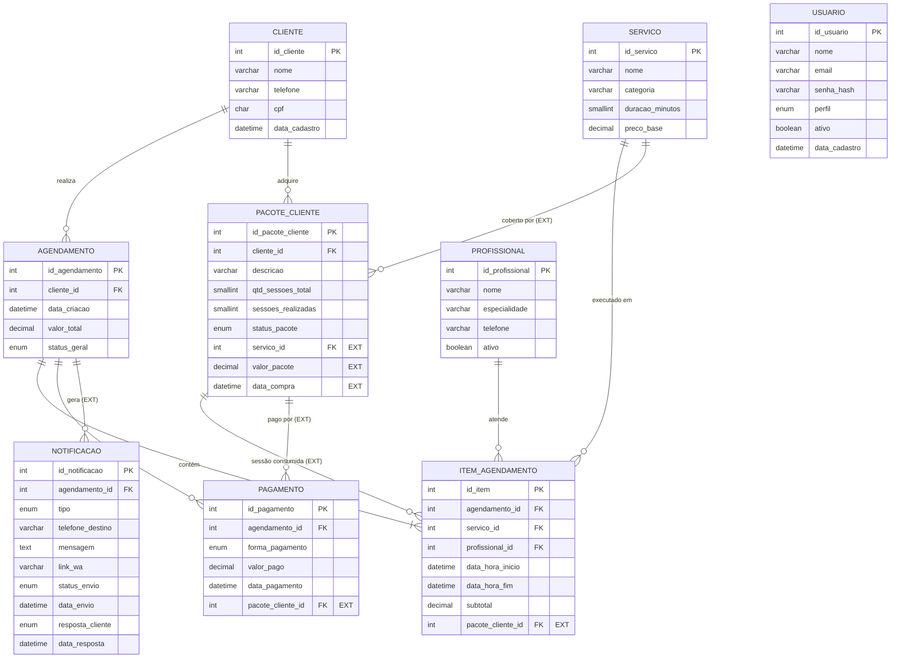

# Modelo Entidade-Relacionamento

Este documento descreve o banco de dados do sistema de agendamentos para salões de beleza. Ele parte do MER original do projeto e registra as **extensões** que foram necessárias para o protótipo funcionar. O script físico está em [`database/schema.sql`](../database/schema.sql).

## Diagrama

As entidades e os campos marcados com `EXT` são extensões ao MER original.

## Extensões ao MER original

| # | Onde | O que foi adicionado | Por quê |
|---|------|----------------------|---------|
| E1 | Nova tabela `usuario` | Login com e-mail, senha em hash e perfil (`admin`/`atendente`) | **LGPD:** CPF e telefone de clientes são dados pessoais e só devem ser acessados por pessoas autenticadas. |
| E2 | Nova tabela `notificacao` | Registro de cada mensagem de WhatsApp: tipo, texto, link `wa.me`, status do envio e resposta do cliente | Evita mensagens duplicadas (no máximo 1 confirmação e 1 lembrete por agendamento) e permite saber quem confirmou presença. |
| E3 | `pacote_cliente.servico_id` | Serviço coberto pelo pacote | Sem ele, o sistema não sabe que serviço o pacote paga. |
| E4 | `pacote_cliente.valor_pacote`, `data_compra` | Valor de venda e data da compra | Permitem incluir os pacotes no faturamento do dashboard. |
| E5 | `item_agendamento.pacote_cliente_id` | Pacote que pagou aquele atendimento (opcional) | Mostra qual atendimento consumiu cada sessão. O item fica com `subtotal = 0`. |
| E6 | `pagamento.pacote_cliente_id` | Pagamento da compra de um pacote | No MER original, um pagamento só podia estar ligado a um agendamento. Agora cada pagamento se liga a **um agendamento ou a um pacote**, nunca aos dois (regra `ck_pagamento_origem`). |

As tabelas e os campos do MER original foram **todos mantidos**, com os mesmos nomes.

## Domínios (valores permitidos)

| Campo | Valores |
|-------|---------|
| `agendamento.status_geral` | `agendado`, `confirmado`, `concluido`, `cancelado`, `falta` |
| `pacote_cliente.status_pacote` | `ativo`, `concluido`, `cancelado` |
| `pagamento.forma_pagamento` | `dinheiro`, `pix`, `cartao_credito`, `cartao_debito` |
| `notificacao.tipo` | `confirmacao`, `lembrete` |
| `notificacao.status_envio` | `pendente`, `simulado`, `enviado`, `falha` |
| `usuario.perfil` | `admin`, `atendente` |

## Regras de integridade

- **Profissional:** a exclusão é lógica (`ativo = FALSE`). As chaves estrangeiras com `RESTRICT` impedem apagar um profissional que tenha histórico.
- **Cliente e Serviço:** a exclusão física é bloqueada (`ON DELETE RESTRICT`) quando existem agendamentos ou pacotes ligados a eles.
- **Itens e notificações:** são apagados junto com o agendamento (`CASCADE`). Pagamentos não, porque são registro financeiro.
- **Conflito de horário:** a API (Passo 4) bloqueia dois atendimentos sobrepostos para o mesmo profissional. A regra de sobreposição é `inicio_existente < novo_fim AND fim_existente > novo_inicio`. O índice `ix_item_profissional_horario` deixa essa consulta rápida.
- **Serviços simultâneos:** o mesmo cliente pode ser atendido ao mesmo tempo por profissionais **diferentes**. Por exemplo, corte e manicure às 09:00.
- **Horário do salão:** é um horário único, configurado no Flask (Passo 2), e não fica no banco.
- **Validações no banco:** o banco também confere valores e durações positivos, horário de fim depois do início, sessões realizadas até o total do pacote e CPF com 11 dígitos.
